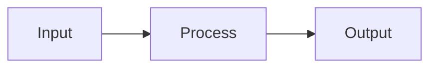
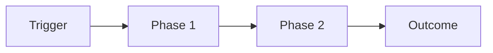

# vaultcraft: phase 4 (concept and work notes)

## Phase 4 - Generate Concept Notes

**Token economy - model routing (enforces Principle 18):**

Phase 4 is mostly mechanical (template-filling) but has judgement-heavy edge cases. Apply 3-tier routing:

- **Haiku (`vaultcraft-writer`)** - bulk concept-note writing from briefs. Standard concepts with clear definitions, common formulas, well-known mechanisms.
- **Sonnet (`vaultcraft-drafter`)** - exemplar notes and hard concepts where the ELI5 analogy needs invention (cross-entropy, backprop, attention, LDA), or where deep extraction is ambiguous and you need to decide whether to split a topic into sub-notes.

Workflow:

1. Build the wikilink registry (below).
2. Assemble per-concept briefs: `{name, source_lecture, key_facts, formula_if_any, example_if_any, difficulty, related_concepts}`.
3. **Sort the inventory** into two queues: easy/templated (Haiku) vs hard/judgement (Sonnet). `difficulty: 1-3` and well-known concepts → Haiku; `difficulty: 4-5` and abstract/novel concepts → Sonnet.
4. **Bulk-process the Haiku queue** with `vaultcraft-writer` calls of at most 10 briefs each, up to 5 in parallel (the work loop in Principle 18).
5. **Send the Sonnet queue to `vaultcraft-drafter`** - these need reasoning, not templating. Its first note of each type is the exemplar for the Haiku writers.
6. Verify outputs pass the post-audit.

Keep your own (Opus) budget for decisions: inventory deduplication, the depth-check, sorting the queues, writing briefs and judging the audit. Do NOT write template prose yourself (Haiku) or narrative notes (Sonnet).

**Build the wikilink registry FIRST (enforces Principle 20):**

Before writing any note, initialize an in-memory set of valid wikilink targets:

```bash
# Existing notes
find <vault> -name '*.md' ! -path '*/.obsidian/*' -exec basename {} .md \; > /tmp/registry.txt
```

Add every note you plan to create to this registry BEFORE writing the notes that reference it. When composing a wikilink, verify the target is in the registry. If not: (a) add a stub and register the name first, (b) use italic fallback `*concept* (see [[Closest Existing]])`, or (c) add as alias to an existing note via frontmatter.

After Phase 4 completes, do a pre-audit sweep:

```bash
python3 -c "
import os, re
vault = '<path>'
existing = {f[:-3] for r,_,fs in os.walk(vault) for f in fs if f.endswith('.md') and '.obsidian' not in r}
aliases = set()
for r,_,fs in os.walk(vault):
    if '.obsidian' in r: continue
    for f in fs:
        if not f.endswith('.md'): continue
        with open(os.path.join(r,f)) as fh:
            for line in fh:
                m = re.match(r'^aliases:\s*\[(.*?)\]', line)
                if m:
                    aliases.update(a.strip() for a in m.group(1).split(','))
valid = existing | aliases
def strip_code(t): return re.sub(r'\`\`\`.*?\`\`\`', '', t, flags=re.DOTALL)
broken = []
for r,_,fs in os.walk(vault):
    if '.obsidian' in r: continue
    for f in fs:
        if not f.endswith('.md'): continue
        with open(os.path.join(r,f)) as fh: c = strip_code(fh.read())
        for m in re.findall(r'\[\[([^\]|#\^]+)', c):
            if m.strip() not in valid: broken.append((f, m.strip()))
print(f'Broken: {len(broken)}')
for b in broken[:20]: print(b)
"
```

Fix every hit before moving to Phase 5. This catches filename drift (plural/singular, L0X prefix) at write time, not post-delivery.

For every concept in the inventory, produce one atomic note. Template:

````markdown
---
tags: [concept]
aliases: [<synonyms>]
source: [[L0X - Lecture Title]]   # OR [[Lab0X - Lab Title]] OR "paper: Author et al. (Year)" OR "textbook: <ref>"
status: new
difficulty: 2
created: <YYYY-MM-DD>
exam-likely: true
---

# <Concept Name>

> [!definition] Definition
> **<Name>** is <one-sentence exam-tight definition, ≤200 characters so it fits the hover preview>.

## Intuition

<2–4 sentences plain language - explain as if to a classmate.>

## Formal details

<Formal definition, assumptions, properties, conditions.>

### Formula

$$
<LaTeX if applicable>
$$

<One line explaining each symbol.>

## Example

```python
# minimal runnable snippet
import numpy as np
...
```

**Output:** <what the code produces>

Or, for math: a worked numerical calculation with real numbers.

## Visualization (optional)



## When to use / When NOT

- Use when: <conditions>
- Avoid when: <conditions>

## Relations

- Specialization of: [[<more-general-concept>]]
- Generalization: [[<broader-concept>]]
- Contrast: [[<similar-but-different>]]
- Applied in: [[<lab-or-lecture>]]

## Exam questions (optional on concept notes; required on lectures)

1. Theory question with pointer.
2. Application question with pointer.

## Flashcards

What is <Name>?::<one-sentence definition>
What is the formula for <X>?::<formula>
When to AVOID <Name>?::<condition>

---
**Sources:** `<slide-or-pdf-filename>`, [wikipedia](<url>)

````

**Rules:**

- Fill every applicable section - if a section genuinely does not apply, delete it (don't leave "TODO" or "N/A").
- Mermaid diagrams for: workflows, state machines, hierarchies, data flows, decision trees. Keep ≤ 12 nodes.
- Python examples must be runnable as-is (include imports, use small illustrative data).
- Flashcards use `::` (inline) - compatible with `obsidian-spaced-repetition`.
- Frontmatter fields: `tags` (single classifier), `aliases`, `source`, `status` (`new` | `review` | `mastered`), `difficulty` (1–5), `created`, `exam-likely` (bool).
- Target length: **250–500 words per atomic concept note**. Lean and hover-friendly.

---

**Work vault note templates (use when `vault-type: work`):**

These replace the study concept-note template. Same hover-definition rule applies: first line after H1 must be a one-sentence summary inside `> [!tldr]`.

**Meeting note:**

```markdown
---
tags: [meeting]
date: <YYYY-MM-DD>
attendees: [<Name>, <Name>]
project: [[<Project>]]
status: open
created: <YYYY-MM-DD>
---

# Meeting — <Topic> (<YYYY-MM-DD>)

> [!tldr] Summary
> <One sentence: what was decided or discussed.>

> [!example]+ 📄 Meeting materials
> ![[<meeting-notes.pdf>]]

## Context

<Why this meeting happened. Link to project or previous meeting.>

## Discussion

### <Topic 1>

<Notes. Inline wikilinks to any concept, person, or company referenced: [[Person Name]], [[Company]], [[Project]].>

![[<relevant-figure-extracted.png>|600]]

### <Topic 2>

<Same pattern.>

## Decisions

> [!important] Decisions made
> 1. <Decision> — owner: [[<Name>]]
> 2. <Decision> — owner: [[<Name>]]

## Action items

- [ ] <Action> — [[<Name>]] — due: <YYYY-MM-DD>
- [ ] <Action> — [[<Name>]] — due: <YYYY-MM-DD>

## Open questions

- <Question> (unresolved, carry to next meeting)

## See also

- Previous: [[Meeting — <Topic> (<prev-date>)]]
- Project: [[<Project>]]
```

**Company / organisation note:**

```markdown
---
tags: [company]
aliases: [<short name>, <acronym>]
sector: <e.g. proptech, sustainability>
status: active
created: <YYYY-MM-DD>
---

# <Company Name>

> [!tldr] In one line
> <What the company does, in one sentence.>

## Profile

| Field | Value |
|-------|-------|
| Website | [company.com](https://company.com) |
| HQ | <City, Country> |
| Size | <employees / ARR estimate> |
| Founded | <Year> |
| Key contacts | [[<Name>]] |

![[<company-logo-or-chart.png>|300]]

## Why relevant

<Why this company matters to your work. Decision criteria, opportunity, risk.>

## Interactions

- [[Meeting — <Topic> (<date>)]]
- [[Email — <subject> (<date>)]]

## Notes

<Ongoing observations, red flags, key facts.>

## Relations

- Competitor of: [[<Other Company>]]
- Partner with: [[<Partner>]]
- Covered in: [[Lead Radar — scan #<N>]]
```

**Decision log note:**

```markdown
---
tags: [decision]
date: <YYYY-MM-DD>
project: [[<Project>]]
status: decided
created: <YYYY-MM-DD>
---

# Decision — <Short title> (<YYYY-MM-DD>)

> [!tldr] Decision
> <What was decided, in one sentence.>

## Context

<What problem or question forced this decision.>

## Options considered

| Option | Pros | Cons |
|--------|------|------|
| **Option A** (chosen) | … | … |
| Option B | … | … |

## Rationale

<Why option A won. What evidence or constraints drove the call.>

> [!warning] Risks
> <What could go wrong. What would invalidate this decision.>

## Consequences

- <What changes as a result>
- <Dependencies affected>

## Review date

<YYYY-MM-DD> — revisit if <condition>.

## See also

- [[Meeting — <where this was discussed>]]
- [[<Project>]]
```

**Person / stakeholder note (`Stakeholders/People/`):**

```markdown
---
tags: [person]
aliases: [<first name>, <nickname>]
company: [[<Company>]]
role: <job title>
email: <email>
phone: <phone>
status: active
created: <YYYY-MM-DD>
---

# <Full Name>

> [!stakeholder] Role
> <Name> is <role> at [[<Company>]] — <one sentence on why they matter to your work>.

## Contact

| Channel | Details |
|---------|---------|
| Email | <email> |
| Phone | <phone> |
| LinkedIn | [Profile](<url>) |

## Documents

> [!example]+ 📄 Stored documents
> ![[Documents/<name>/<contract.pdf>]]
> ![[Documents/<name>/<brief.pdf>]]

*(Drop any PDFs related to this person into `Documents/<name>/` — they'll embed here.)*

## Interaction history

- [[Meeting — <topic> (<date>)]]
- [[Meeting — <topic> (<date>)]]

## Notes

<Ongoing observations, preferences, red flags, context.>

## Relations

- Works at: [[<Company>]]
- Involved in: [[<Project>]]
- Knows: [[<Other Person>]]
```

**Project / topic note (work hub):**

````markdown
---
tags: [project]
aliases: [<short name>]
status: active
owner: [[<Name>]]
deadline: <YYYY-MM-DD>
created: <YYYY-MM-DD>
---

# <Project Name>

> [!tldr] Goal
> <What this project is trying to achieve, in one sentence.>

## Overview

<Context: why this project exists, who cares, what success looks like.>



## Key documents

> [!example]+ 📄 Project brief
> ![[<brief.pdf>]]

![[<architecture-diagram.png>|600]]

## Status

| Phase | Status | Owner | Due |
|-------|--------|-------|-----|
| Research | ✅ done | [[<Name>]] | <date> |
| Design | 🔄 in progress | [[<Name>]] | <date> |
| Build | ⬜ pending | — | <date> |

## Decisions

- [[Decision — <title> (<date>)]]

## Meetings

- [[Meeting — <topic> (<date>)]]

## People

- [[<Stakeholder>]] — <role>
- [[<Client>]] — <role>

## Open questions

- <Question>

````
